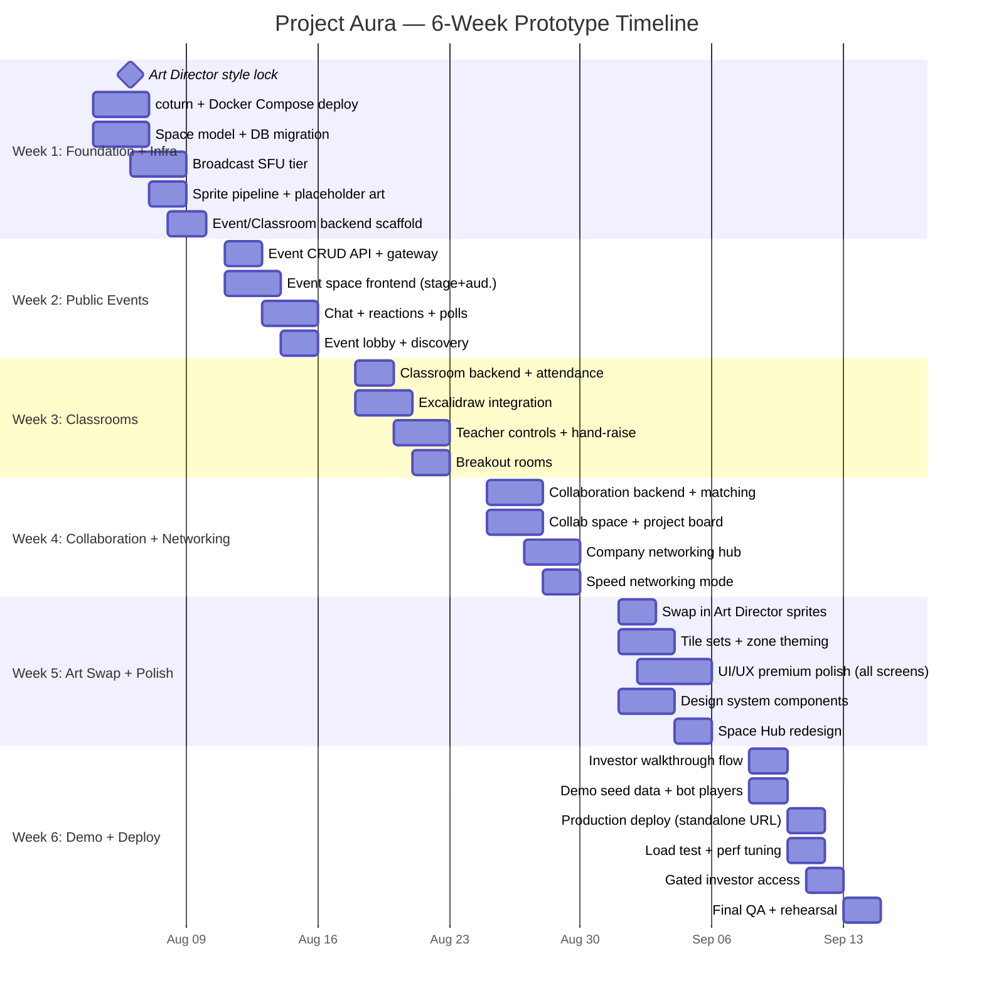
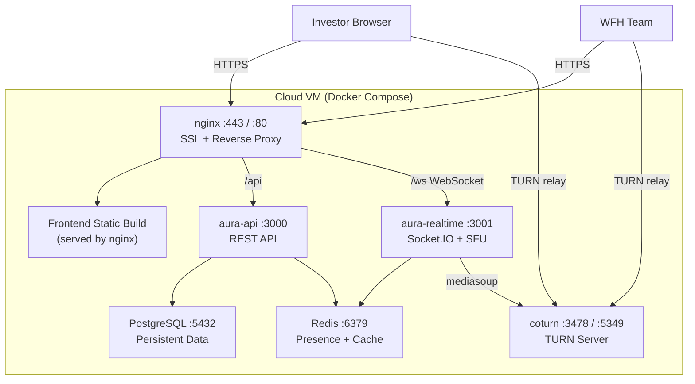
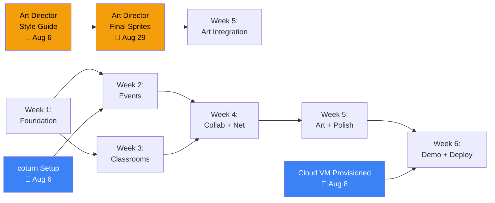

# Project Aura — 6-Week Investor Prototype Implementation Plan

> **Deadline**: September 15, 2026 (6 weeks from August 4)  
> **Goal**: A walkthrough-ready, visually polished prototype with limited investor access demonstrating 5 core modules.

---

## Current State Assessment

### What Already Exists ✅

| Layer | Status | Details |
|-------|--------|---------|
| **Auth** | ✅ Working | Login, registration, JWT, invite flow |
| **Virtual Office** | ✅ Working | Isometric 2D canvas (Phaser 3), player movement, zone detection, meeting rooms |
| **Real-time Infra** | ✅ Working | Socket.IO gateway, Redis presence, zone events, meeting events |
| **SFU Media** | ✅ Working | mediasoup-based spatial audio, proximity system, camera/mic/screen share |
| **Office Builder** | ✅ Working | Furniture catalog, drag-and-drop placement, occupancy grid |
| **Desktop App** | ✅ Working | Electron wrapper with dev and build scripts |
| **Database** | ✅ Working | PostgreSQL via TypeORM — Company, User, Office, Zone, Role, Invite, FurniturePlacement entities |

### What Needs to Be Built 🔨

| Feature | Effort | Priority |
|---------|--------|----------|
| **Public Events (1000+ capacity)** | High | P0 |
| **Virtual Classrooms** | Medium | P0 |
| **Industry-Academia Collaboration** | Medium | P1 |
| **Company Networking Hub** | Medium | P1 |
| **Visual Art Overhaul (Animated Sprites + UI)** | High | P0 |
| **TURN Server + Deployment** | Medium | P0 |
| **Investor Walkthrough & Gated Access** | Low | P0 |

---

## Resolved Decisions

> [!NOTE]
> ### All open questions have been answered. These are now locked decisions:

### 1. TURN Server — Self-hosted coturn (mandatory)
- Deploy **coturn** on the same cloud VM (or a separate small VM) for NAT traversal
- Required for: WFH team members, remote investors, any cross-network WebRTC
- coturn is free, open-source, and lightweight
- Configuration: STUN + TURN with long-term credentials tied to our JWT auth
- Deployed in **Week 1** as part of infrastructure setup so all subsequent dev/testing uses it

### 2. Deployment Target — Standalone URL (primary), local fallback
- Primary: `demo.aura.echofox.dev` (or similar) on a cloud VM
- Stack: Docker Compose (PostgreSQL + Redis + coturn + aura-api + aura-realtime + nginx)
- Fallback: If deployment hits blockers, prepare a polished local setup script
- SSL via Let's Encrypt (free) through nginx reverse proxy

### 3. Art Style — Locked by Art Director in Week 1
- **Week 1 deliverable**: Art Director locks the visual style guide (palette, proportions, line weight, mood)
- All sprite work, tile sets, and UI theming wait for this style guide
- **Risk mitigation**: Dev work proceeds with placeholder sprites that match the correct dimensions/animation-frame counts. Art Director's assets are hot-swapped in once delivered
- The plan builds the **art pipeline** in Week 1 (sprite sheet loading, animation system, tile renderer) so assets can be dropped in without code changes

### 4. Avatars — Fully Animated Character Sprites
- 8-directional isometric character sprites (minimum 4 presets for prototype)
- Animations: **idle** (4 frames), **walk** (8 frames), **sit** (4 frames)
- Color palette system for customization (mapped via `avatarConfig.paletteId`)
- Art Director provides the style; dev team builds the sprite sheet loader and animation state machine
- Placeholder: properly-proportioned silhouette sprites with correct frame counts so animation code is testable before art lands

### 5. Whiteboard — Excalidraw Embedded
- Embed [Excalidraw](https://github.com/excalidraw/excalidraw) React component directly into classroom spaces
- Excalidraw is MIT-licensed, free, and provides: freehand drawing, shapes, text, arrows, collaboration-ready data model
- Real-time sync via Excalidraw's collaboration protocol routed through our Socket.IO gateway
- Teacher controls: clear board, lock student editing, save/export whiteboard as PNG
- No external service needed — fully self-hosted within our app

### 6. Infrastructure Budget — Free/Self-hosted, Scalable for Future
- **Development**: All services self-hosted via Docker Compose (PostgreSQL, Redis, coturn — all free)
- **Deployment for demo**: Single cloud VM (cheapest option that can run Docker):
  - Option A: Oracle Cloud Free Tier (ARM, 4 OCPU, 24GB RAM — **permanently free**)
  - Option B: Hetzner CX22 (~€4/month) or DigitalOcean Basic ($6/month)
  - Option C: AWS EC2 t3.medium (~$30/month, 12-month free tier eligible)
- **Future scaling**: Architecture uses Docker Compose now, designed to migrate to Kubernetes/ECS later
  - Redis → managed Redis (AWS ElastiCache / Upstash free tier)
  - PostgreSQL → managed Postgres (Neon free tier / Supabase / RDS)
  - mediasoup → horizontal scaling with `@socket.io/redis-adapter` (already referenced in backend README)
  - coturn → can scale to managed TURN (Cloudflare TURN is free for < 100GB/month)

---

## Architecture Decisions

> [!IMPORTANT]
> ### SFU Scaling for 1000+ Users
> The current mediasoup SFU is peer-to-peer relay scoped per office. For public events with 1000+ attendees, we use a **broadcast-tier SFU** pattern:
> - **Speakers/Presenters** (1–10): Full send+recv transports via mediasoup
> - **Audience** (1000+): Recv-only consumers, no send transports. The SFU only creates recv transports for audience
> - **Audience interaction**: Socket.IO events only (chat, reactions, Q&A) — no media, server-side rate-limiting
> - **Capacity**: A single mediasoup worker handles ~500–800 audio-only or ~200–400 video consumers. Multiple workers round-robin for larger events
> - **Investor demo target**: 50 real users + load simulation dashboard proving the architecture

> [!IMPORTANT]
> ### Unified "Space" Model
> All experiences share the same spatial engine but with different **SpaceType** configurations:
> - `OFFICE` — Current behavior. Private to a company. Proximity audio, meeting zones, desks
> - `EVENT` — Public. Stage/audience layout. Broadcast media. Chat/reactions/polls
> - `CLASSROOM` — Semi-public. Teacher controls. Excalidraw whiteboard. Breakout rooms. Attendance
> - `COLLAB_HUB` — Cross-org. Project boards. Shared workspaces. Matchmaking

> [!IMPORTANT]
> ### Art Pipeline — Decoupled from Code
> The sprite system is built with a **hot-swap architecture**: code references animation keys and preset IDs, not specific image files. When the Art Director delivers final assets, they replace placeholder files at known paths and dimensions — zero code changes needed.

---

## Proposed Changes

### Sprint Structure (6 Weeks)



---

### Week 1: Foundation, Infrastructure & Art Pipeline (Aug 4–10)

#### Infrastructure — TURN Server + Deployment Scaffold

##### [NEW] `deploy/docker-compose.prod.yml`
- Production Docker Compose with all services:
  - `postgres:16-alpine` — database
  - `redis:7-alpine` — cache/presence
  - `coturn` — TURN server (using `coturn/coturn:latest` image)
  - `aura-api` — REST API (built from Dockerfile)
  - `aura-realtime` — WebSocket gateway (built from Dockerfile)
  - `nginx:alpine` — reverse proxy with SSL termination
- Volume mounts for persistent data, environment variable injection

##### [NEW] `deploy/coturn/turnserver.conf`
- coturn configuration:
  - Listening port: 3478 (UDP+TCP)
  - TLS port: 5349
  - Relay ports: 49152–65535
  - Long-term credential mechanism linked to a shared secret
  - Realm: `turn.aura.echofox.dev`
  - Log to file for debugging

##### [NEW] `deploy/nginx/nginx.conf`
- Reverse proxy routing:
  - `/api/*` → `aura-api:3000`
  - `/ws/*` → `aura-realtime:3001` (WebSocket upgrade support)
  - `/` → serve frontend static build
- SSL with Let's Encrypt (certbot) or self-signed for initial dev
- WebSocket proxy headers (`Upgrade`, `Connection`)

##### [NEW] `deploy/Dockerfile.api` + `deploy/Dockerfile.realtime`
- Multi-stage build: install deps → build → slim runtime image
- Non-root user for security

##### [MODIFY] [mediasoup.service.ts](file:///d:/Echofox/Project_Aura/apps/aura-realtime/src/sfu/mediasoup.service.ts)
- Add TURN server ICE server configuration from env vars
- Pass `iceServers` array (STUN + TURN) to all WebRTC transport creations
- New env vars: `TURN_URL`, `TURN_USERNAME`, `TURN_CREDENTIAL`

##### [MODIFY] [sfu.constants.ts](file:///d:/Echofox/Project_Aura/apps/aura-realtime/src/sfu/sfu.constants.ts)
- Add TURN server configuration constants
- Add `SFU_ICE_SERVERS` builder function reading from ConfigService

---

#### Backend — Space Model Extension

##### [MODIFY] [zone.entity.ts](file:///d:/Echofox/Project_Aura/libs/database/src/entities/zone.entity.ts)
- Extend `ZoneType` enum: add `STAGE`, `AUDIENCE`, `CLASSROOM_TEACHER`, `CLASSROOM_STUDENT`, `BREAKOUT`, `COLLAB_WORKSPACE`, `NETWORKING_TABLE`

##### [NEW] `libs/database/src/entities/space.entity.ts`
- New `Space` entity — generalizes `Office` for all space types
- Fields: `id`, `name`, `type` (enum: `OFFICE | EVENT | CLASSROOM | COLLAB_HUB`), `capacity`, `isPublic`, `ownerId` FK, `companyId` FK (nullable for cross-org), `layoutConfig` (JSONB — grid dimensions, tile theme, zone template), `scheduledAt`, `endsAt`, `status` (DRAFT/LIVE/ENDED/ARCHIVED)
- Relation: `Space` has many `Zone`s; `Space` belongs to `Company` (optional); `Space` belongs to `User` (owner)
- `Office` entity continues to work for existing offices; `Space` wraps new space types

##### [NEW] `libs/database/src/entities/event.entity.ts`
- Event-specific metadata linked to a `Space`
- Fields: `id`, `title`, `description`, `bannerUrl`, `maxAttendees`, `registeredCount`, `status` (DRAFT/LIVE/ENDED), `spaceId` FK
- `speakers` JSONB: `{ userId: string, name: string, role: 'host' | 'speaker' | 'moderator' }[]`
- `settings` JSONB: `{ chatEnabled: boolean, reactionsEnabled: boolean, pollsEnabled: boolean, qnaEnabled: boolean }`

##### [NEW] `libs/database/src/entities/classroom.entity.ts`
- Fields: `id`, `subject`, `description`, `teacherId` FK, `spaceId` FK
- `schedule` JSONB: `{ dayOfWeek: number, startTime: string, endTime: string }[]`
- `settings` JSONB: `{ attendanceRequired: boolean, whiteboardEnabled: boolean, breakoutRoomsEnabled: boolean, studentMicDefault: 'muted' | 'unmuted' }`

##### [NEW] `libs/database/src/entities/classroom-enrollment.entity.ts`
- Join table: `studentId` FK, `classroomId` FK, `enrolledAt`, `status` (ACTIVE/DROPPED)

##### [NEW] `libs/database/src/entities/attendance.entity.ts`
- Fields: `id`, `studentId` FK, `classroomId` FK, `date`, `joinedAt`, `leftAt`, `durationMinutes`

##### [NEW] `libs/database/src/entities/collaboration.entity.ts`
- Fields: `id`, `title`, `description`, `companyId` FK, `spaceId` FK (nullable — created on acceptance), `projectType` (INTERNSHIP/RESEARCH/CAPSTONE/OPEN), `status` (OPEN/IN_PROGRESS/COMPLETED), `requiredSkills` JSONB array, `timeline` JSONB

##### [NEW] `libs/database/src/entities/collaboration-application.entity.ts`
- Fields: `id`, `collaborationId` FK, `applicantUserId` FK, `applicantCompanyId` FK (nullable, for college orgs), `message` text, `status` (PENDING/ACCEPTED/REJECTED), `appliedAt`

##### [NEW] `libs/database/src/entities/connection.entity.ts`
- For networking: `id`, `fromUserId` FK, `toUserId` FK, `status` (PENDING/ACCEPTED/DECLINED), `connectedAt`

##### [MODIFY] [office.gateway.ts](file:///d:/Echofox/Project_Aura/apps/aura-realtime/src/gateways/office.gateway.ts)
- Add space-type awareness to the `office:join` handler
- For `EVENT` spaces: only register speakers as full SFU peers; audience gets recv-only transport
- For `CLASSROOM` spaces: teacher gets full peer; students get recv-only unless unmuted by teacher
- New Socket.IO middleware validates space-type-specific permissions

##### [NEW] `apps/aura-api/src/event/event.controller.ts` + `event.service.ts` + `event.module.ts`
- `POST /events` — create event (creates Space + Event, auth required)
- `GET /events/public` — list upcoming public events (no auth for browsing)
- `GET /events/:id` — event details with speaker list
- `POST /events/:id/register` — register for event
- `DELETE /events/:id/register` — unregister

##### [NEW] `apps/aura-realtime/src/gateways/event.gateway.ts`
- Socket.IO namespace or event-prefixed messages for event-specific real-time
- Events: `event:chat`, `event:reaction`, `event:question`, `event:poll-vote`
- Server-side rate limiting: max 5 chat messages/sec/user, reaction deduplication per user per 2s

---

#### Backend — Broadcast SFU Tier

##### [MODIFY] [mediasoup.service.ts](file:///d:/Echofox/Project_Aura/apps/aura-realtime/src/sfu/mediasoup.service.ts)
- New method `registerBroadcastConsumer(officeId, userId, socketId)` — creates recv-only transport (no send)
- New method `registerSpeakerPeer(officeId, userId, socketId)` — creates send+recv transports (existing behavior)
- Add consumer-count tracking per room with configurable limit (`SFU_MAX_CONSUMERS_PER_ROOM`)
- When limit approached, reject new consumers with a `room-full` error

##### [MODIFY] [spatial-audio.service.ts](file:///d:/Echofox/Project_Aura/apps/aura-realtime/src/sfu/spatial-audio.service.ts)
- Add `reconcileEvent()` path: in EVENT spaces, all audience members consume all speaker producers (no distance culling)
- Existing proximity-based reconcile continues to work for OFFICE spaces
- Classroom: teacher always heard by all students; student-to-student uses proximity within breakout rooms

---

#### Frontend — Sprite Pipeline + Art Placeholders

##### [MODIFY] [PlayerSprite.ts](file:///d:/Echofox/project_Aura_FE/src/modules/spatial/entities/PlayerSprite.ts)
- Replace colored-circle rendering with Phaser sprite sheet animation system
- Animation state machine: `idle-{direction}`, `walk-{direction}`, `sit-{direction}` (8 directions: N, NE, E, SE, S, SW, W, NW)
- Sprite sheet loader: reads from `public/assets/sprites/avatar-{presetId}.png` with standardized frame layout
- Nameplate rendering: text above sprite with background pill, status dot (green/yellow/red)
- Direction calculated from velocity vector, snapped to nearest 8-way direction
- **Placeholder sprites**: Simple silhouette stick-figures at correct 64×64 pixel frame size, 8 directions × 3 states, generated via canvas as temp art

##### [NEW] `src/modules/spatial/utils/sprite-animation.ts`
- Animation key registry: maps `{presetId}-{state}-{direction}` to frame ranges
- Standardized frame layout constant: rows = states (idle/walk/sit), columns = directions × frame count
- Helper: `createAvatarAnimations(scene, presetId)` — registers all animations for a preset
- Helper: `getAnimationKey(presetId, state, direction)` — resolves the correct animation key

##### [NEW] `src/modules/spatial/utils/placeholder-sprites.ts`
- Canvas-based placeholder sprite sheet generator (replaces colored circles)
- Generates a 512×384 sprite sheet with 8-direction × 3-state frames
- Properly proportioned humanoid silhouette (not circles)
- Color tinted based on `paletteId`
- This is the **hot-swap target** — when Art Director delivers final `.png` sheets, these placeholders are simply no longer loaded

##### [MODIFY] [types.ts](file:///d:/Echofox/project_Aura_FE/src/core/types.ts)
- Add `SpaceType` enum: `OFFICE | EVENT | CLASSROOM | COLLAB_HUB`
- Add new zone types to `ZoneType` enum (matching backend)
- Add interfaces: `EventDetails`, `ClassroomDetails`, `CollaborationProject`, `ConnectionRequest`
- Add event-specific socket event types

##### [MODIFY] [game.store.ts](file:///d:/Echofox/project_Aura_FE/src/core/store/game.store.ts)
- Add `spaceType: SpaceType` field
- Add `isAudienceMember: boolean` (true for event audience, false for speakers/office users)
- Conditional behavior branching based on `spaceType`

---

### Week 2: Public Events System (Aug 11–17)

#### Backend — Event Infrastructure

##### [NEW] `apps/aura-realtime/src/services/event-chat.service.ts`
- Redis-backed chat message store: `event:{eventId}:chat` as Redis list (capped at 500 messages)
- Rate limiting: per-user token bucket (5 msg/sec) using Redis `INCR` with TTL
- Message schema: `{ id, userId, userName, content, timestamp, type: 'message' | 'question' }`
- Moderator actions: `deleteMessage(messageId)`, `muteUser(userId, durationSec)`, `setSlowMode(intervalSec)`

##### [NEW] `apps/aura-realtime/src/services/event-reaction.service.ts`
- Redis sorted set: `event:{eventId}:reactions:{emoji}` — score = count
- Per-user dedup: `event:{eventId}:reacted:{userId}` set with 2-second TTL per emoji
- Batched broadcast: aggregate reactions every 500ms and emit `event:reaction-burst` with counts
- Supported emojis: 👏 ❤️ 🔥 😂 🤔 👀 (fixed set for prototype)

##### [NEW] `apps/aura-realtime/src/services/event-poll.service.ts`
- Redis hash: `event:{eventId}:poll:{pollId}` with fields: question, options (JSONB), votes per option
- Per-user single vote: `event:{eventId}:poll:{pollId}:voted` set
- Events: `event:poll-created`, `event:poll-vote`, `event:poll-closed`, `event:poll-results`
- Only speakers/moderators can create and close polls

##### [MODIFY] `apps/aura-realtime/src/gateways/event.gateway.ts`
- Wire up chat, reaction, and poll services
- Add Socket.IO event handlers for all event interactions
- Emit `event:chat-message`, `event:reaction-burst`, `event:poll-*` events

#### Frontend — Event Space Experience

##### [NEW] `src/modules/events/store/event.store.ts`
- Zustand store for event state: current event details, chat messages, reactions, polls, speaker list
- Actions: sendChatMessage, sendReaction, votePoll, etc.

##### [NEW] `src/modules/events/ui/EventLobbyScreen.tsx`
- Public event listing page — accessible from the Space Hub
- Event cards: banner image, title, date/time, attendee count, "Join" / "Register" button
- Search bar + category filter (Tech, Education, Networking, etc.)
- Glassmorphism card design with hover lift animation
- "Create Event" button for authenticated users

##### [NEW] `src/modules/events/ui/EventSpaceContainer.tsx`
- Main event experience container (variant of `GameContainer`)
- Layout: **Stage area** (top 40% of viewport) + **Audience spatial area** (bottom 60%)
- Stage: Large video tiles for speakers (1–6 grid, active speaker highlighted)
- Audience: Isometric grid where attendee avatars are rendered (Phaser scene)
- Sidebar: Tabbed panel with Chat | Q&A | Polls
- Bottom bar: Reaction bar + mute/camera controls (if speaker)

##### [NEW] `src/modules/events/ui/components/StageView.tsx`
- Speaker video grid component
- Active speaker detection (border glow on loudest speaker)
- Speaker name labels, role badges (Host / Speaker / Moderator)
- Screen share: replaces grid with featured screen + small speaker thumbnails
- Fullscreen toggle for stage area

##### [NEW] `src/modules/events/ui/components/EventChat.tsx`
- Scrollable chat panel with auto-scroll on new messages
- Message bubbles: username (colored), message, timestamp
- Input field with send button, emoji picker
- "Ask a Question" toggle (changes message type for Q&A tab)
- Slow mode indicator when active

##### [NEW] `src/modules/events/ui/components/ReactionBar.tsx`
- Horizontal emoji bar fixed at bottom of audience area
- Click emoji → send reaction → particle animation of that emoji floating up from audience
- Aggregate reaction counts shown briefly after burst
- Smooth CSS animation for emoji particles (scale up, float, fade)

##### [NEW] `src/modules/events/ui/components/PollWidget.tsx`
- Live poll card in sidebar: question, options as radio buttons, vote button
- After voting: animated horizontal bar chart showing real-time percentages
- Poll status: ACTIVE / CLOSED with results

##### [NEW] `src/modules/events/scenes/EventScene.ts`
- Phaser scene for event spaces
- Audience avatar grid: condensed isometric layout (more avatars per screen than office)
- No free roaming for audience — fixed camera on a crowd view
- Emoji reaction particles spawned above random audience avatars
- Stage zone rendered as elevated platform with spotlight effect

---

### Week 3: Virtual Classrooms with Excalidraw (Aug 18–24)

#### Backend — Classroom Infrastructure

##### [NEW] `apps/aura-api/src/classroom/classroom.controller.ts` + `classroom.service.ts` + `classroom.module.ts`
- `POST /classrooms` — create classroom (teacher/admin only, creates Space + Classroom)
- `GET /classrooms` — list classrooms (teacher: their classes; student: enrolled classes)
- `GET /classrooms/:id` — classroom details with enrollment list
- `POST /classrooms/:id/enroll` — student self-enrollment
- `GET /classrooms/:id/attendance` — attendance records (teacher only)
- `DELETE /classrooms/:id/enroll` — student drop

##### [NEW] `apps/aura-realtime/src/gateways/classroom.gateway.ts`
- Socket.IO events for classroom interactions:
  - `classroom:hand-raise` / `classroom:hand-lower` — student hand raise queue
  - `classroom:mute-all` — teacher mutes all student mics (pauses their SFU producers)
  - `classroom:unmute-student` — teacher selectively unmutes a student
  - `classroom:spotlight` — teacher spotlights a student's video to everyone
  - `classroom:breakout-create` — teacher creates breakout rooms (creates temporary BREAKOUT zones)
  - `classroom:breakout-assign` — teacher assigns students to breakout rooms
  - `classroom:breakout-close` — teacher ends breakout session, pulls everyone back

##### [NEW] `apps/aura-realtime/src/services/whiteboard.service.ts`
- Excalidraw collaboration relay — receives Excalidraw scene update deltas via Socket.IO
- Redis storage: `classroom:{classroomId}:whiteboard` — stores latest Excalidraw scene JSON
- Events: `whiteboard:update` (broadcast delta), `whiteboard:state` (full state on join), `whiteboard:clear`
- Teacher permissions: clear board, lock/unlock student editing

##### [NEW] `apps/aura-realtime/src/services/attendance.service.ts`
- Auto-log attendance when student connects to classroom space
- Redis tracking: `classroom:{classroomId}:attendance:{date}` hash — `userId → { joinedAt, lastSeen }`
- On disconnect: calculate duration, persist to PostgreSQL `Attendance` entity
- Heartbeat-based: if student's heartbeat lapses > 2 min, mark as "left early"

##### [NEW] `apps/aura-realtime/src/services/breakout.service.ts`
- Create temporary BREAKOUT zone entries in Redis (not persisted to DB)
- Assign students to breakout rooms: move their zone membership in Redis
- Timer: auto-close breakout rooms after configurable duration
- On close: emit `classroom:breakout-ended`, students' zone membership reverts to main classroom

#### Frontend — Classroom Experience

##### [NEW] `src/modules/classroom/store/classroom.store.ts`
- Zustand store: current classroom, enrollment list, hand-raise queue, whiteboard state, breakout assignments
- Actions: raiseHand, lowerHand, requestBreakout, etc.

##### [NEW] `src/modules/classroom/ui/ClassroomDashboard.tsx`
- **Teacher view**: list of their classrooms, "Create Classroom" button, attendance summaries
- **Student view**: enrolled classrooms, available classrooms to join, schedule view
- Card layout with subject, teacher name, schedule, student count
- "Join Class" button → enters classroom space

##### [NEW] `src/modules/classroom/ui/ClassroomSpaceContainer.tsx`
- Modified spatial container for classroom layout:
  - Teacher area at front (larger zone, with whiteboard overlay)
  - Student desk zones in rows behind teacher
  - Breakout room zones on sides (appear/disappear dynamically)
- Teacher video prominently displayed at top
- Student video thumbnails in a strip below

##### [NEW] `src/modules/classroom/ui/components/ExcalidrawWhiteboard.tsx`
- Embeds `@excalidraw/excalidraw` React component
- Props: `isTeacher` (controls editing permissions), `classroomId` (for sync channel)
- Real-time sync: onChange → emit `whiteboard:update` via Socket.IO → broadcast to all
- On join: receive `whiteboard:state` with full Excalidraw scene
- Teacher toolbar additions: "Clear Board", "Lock Editing", "Save Snapshot"
- Fullscreen toggle to maximize whiteboard view

##### [NEW] `src/modules/classroom/ui/components/HandRaiseQueue.tsx`
- Teacher view: ordered list of students with raised hands, "Call On" button
- Student view: "Raise Hand" / "Lower Hand" toggle button in their toolbar
- Animated hand icon with bounce animation when raised
- Called-on student gets visual highlight and mic auto-unmuted

##### [NEW] `src/modules/classroom/ui/components/BreakoutPanel.tsx`
- Teacher UI: "Create Breakout Rooms" → specify count + assignment (auto/manual)
- Room cards showing assigned students
- Timer display + "Close All Rooms" button
- Student UI: notification when assigned to breakout, room info display

##### [NEW] `src/modules/classroom/ui/components/TeacherToolbar.tsx`
- Floating toolbar for teacher role:
  - Mute All / Unmute All
  - Spotlight Student (dropdown)
  - Share Screen
  - Open Whiteboard (fullscreen)
  - Breakout Rooms
  - View Attendance
- Compact pill-style design to not obstruct the spatial view

##### [NEW] `src/modules/classroom/scenes/ClassroomScene.ts`
- Phaser scene with classroom layout:
  - Teacher podium zone at front (elevated, accent color)
  - Student desk grid (3–4 rows, auto-arranged based on enrollment)
  - Whiteboard "zone" behind teacher (triggers whiteboard overlay when clicked)
  - Breakout room zones on left/right sides (dynamic — appear when created by teacher)

---

### Week 4: Industry-Academia Collaboration & Company Networking (Aug 25–31)

#### Backend — Collaboration

##### [NEW] `apps/aura-api/src/collaboration/collaboration.controller.ts` + `collaboration.service.ts` + `collaboration.module.ts`
- `POST /collaborations` — company creates a project (with required skills, timeline, description)
- `GET /collaborations` — browse all open collaborations (public, filterable)
- `GET /collaborations/:id` — project details with applications
- `POST /collaborations/:id/apply` — student/college applies (with message)
- `PUT /collaborations/:id/applications/:appId` — accept/reject application
- On acceptance: auto-create a `COLLAB_HUB` space for the project with both company + student as members

##### [NEW] `apps/aura-api/src/collaboration/project-board.service.ts`
- Simple kanban board backend: Redis-backed for real-time, with periodic DB persistence
- `POST /collaborations/:id/board/cards` — create card (title, description, assignee)
- `PUT /collaborations/:id/board/cards/:cardId` — update card (move column, edit)
- `DELETE /collaborations/:id/board/cards/:cardId` — delete card
- Columns: TODO | IN_PROGRESS | REVIEW | DONE
- Socket.IO events for real-time card updates: `board:card-created`, `board:card-moved`, `board:card-deleted`

#### Backend — Company Networking

##### [NEW] `apps/aura-api/src/networking/networking.controller.ts` + `networking.service.ts` + `networking.module.ts`
- `GET /companies/discover` — browse companies (filter: industry, size, location, open-for-collab)
- `GET /companies/:id/profile` — public company profile
- `POST /connections` — send connection request to user/company
- `PUT /connections/:id` — accept/decline connection
- `GET /connections` — list connections (pending/accepted)
- `POST /networking/speed-sessions` — create speed networking event (admin)
- `POST /networking/speed-sessions/:id/join` — join speed networking queue

##### [NEW] `apps/aura-realtime/src/services/speed-networking.service.ts`
- Matchmaking queue: Redis sorted set by join time
- Pair algorithm: FIFO pairing, or preference-based (industry match) as stretch
- Timer: 5-minute countdown per pair, auto-rotate on expiry
- Events: `speed:paired` (with partner info), `speed:timer-tick`, `speed:rotate`, `speed:session-ended`
- Creates temporary 1:1 MEETING zone for each pair

#### Frontend — Collaboration Hub

##### [NEW] `src/modules/collaboration/store/collab.store.ts`
- State: available projects, my applications, my projects, project board cards

##### [NEW] `src/modules/collaboration/ui/CollabDashboard.tsx`
- **Company view**: "Post a Project" form, view applications, manage active projects
- **Student view**: browse projects, apply, track application status
- Project cards: company name/logo, title, skills tags, timeline, "Apply" button
- Premium card design with skill tag pills, company avatar

##### [NEW] `src/modules/collaboration/ui/CollabSpaceContainer.tsx`
- Shared workspace for an active collaboration:
  - Spatial area where team members can move and talk
  - Overlay panel with project board (kanban)
  - Shared document links section
  - Meeting schedule widget

##### [NEW] `src/modules/collaboration/ui/components/ProjectBoard.tsx`
- Kanban board component: 4 columns, drag-and-drop cards
- Card: title, assignee avatar, due date, priority color
- Add card form (inline in column)
- Real-time updates via Socket.IO

##### [NEW] `src/modules/collaboration/ui/components/ProjectCard.tsx`
- Used in dashboard listings: company logo, project title, skills, timeline, status badge
- "Apply" / "View Details" actions

#### Frontend — Networking Hub

##### [NEW] `src/modules/networking/store/networking.store.ts`
- State: discovered companies, connections, speed networking session

##### [NEW] `src/modules/networking/ui/NetworkingHub.tsx`
- Company discovery grid: search + filter by industry/size
- "My Connections" tab with pending/accepted connections
- "Upcoming Networking Events" list

##### [NEW] `src/modules/networking/ui/NetworkingLoungeContainer.tsx`
- Spatial networking space:
  - Round table zones (4-seat capacity each) for small group conversations
  - Lounge area for casual walk-around networking
  - "Speed Networking" button → enters matchmaking queue

##### [NEW] `src/modules/networking/ui/components/CompanyCard.tsx`
- Company card: logo/avatar, name, industry, size, description snippet
- "View Profile" → full profile modal
- "Connect" button

##### [NEW] `src/modules/networking/ui/components/SpeedNetworkingOverlay.tsx`
- Full-screen overlay when in speed networking mode:
  - Partner video tile (large, centered)
  - Countdown timer (5:00 → 0:00)
  - Partner info card: name, company, role, interests
  - "Connect" button to save this connection
  - "Skip" button (move to next partner early)

##### [NEW] `src/modules/networking/ui/components/CompanyProfile.tsx`
- Full-page company profile modal/screen:
  - Header: logo, name, tagline, industry
  - About section
  - Stats: size, location, active collaborations
  - Team members visible in Aura
  - "Connect" / "View Open Projects" CTAs

---

### Week 5: Art Swap & Premium UI Polish (Sep 1–7)

> [!IMPORTANT]
> This is when Art Director's finalized assets are integrated. The sprite pipeline from Week 1 makes this a file-drop operation for character art.

#### Art Asset Integration

##### [UPDATE] `public/assets/sprites/avatar-{presetId}.png` (4+ files)
- Replace placeholder sprite sheets with Art Director's finalized character art
- Same frame layout: 8 directions × 3 states (idle/walk/sit) × N frames per state
- **Zero code changes** — the sprite animation system from Week 1 reads these by convention

##### [NEW] `public/assets/tiles/floor-{theme}.png` (5+ tile themes)
- Tile set sprite sheets: wood, marble, carpet, concrete, grass
- Each tile set: base tile + edge tiles + corner tiles for seamless rendering
- Loaded by theme name from `Space.layoutConfig.tileTheme`

##### [NEW] `public/assets/tiles/zone-{type}.png`
- Zone-specific accent tiles: stage platform edges, classroom desk overlay, networking table
- Semi-transparent overlays rendered on top of base floor tiles

##### [NEW] `public/assets/furniture/` (replace all canvas-drawn furniture)
- Proper isometric furniture sprites from Art Director
- Replace `ensureFurnitureTextures()` canvas generation with sprite sheet loading
- Categories: desk, chair, monitor, plant, whiteboard, stage-light, couch, bookshelf, coffee-table

##### [NEW] `public/assets/ui/icons/` — Custom UI icons
- Space type icons: office, event, classroom, collab, networking
- Status icons: online, busy, away, offline
- Feature icons: whiteboard, breakout, poll, reaction, hand-raise

#### UI/UX Premium Polish

##### [NEW] `src/core/ui/design-system/GlassCard.tsx`
- Glassmorphism card: `background: rgba(255,255,255,0.05)`, `backdrop-filter: blur(16px)`, subtle border glow
- Props: `variant` ('default' | 'elevated' | 'interactive'), `glowColor`
- Hover: slight lift + glow intensity increase

##### [NEW] `src/core/ui/design-system/GradientButton.tsx`
- Premium gradient buttons with animated gradient shift on hover
- Variants: primary (cyan→blue), secondary (slate), danger (rose), success (emerald)
- Loading state with spinner

##### [NEW] `src/core/ui/design-system/AnimatedBackground.tsx`
- Subtle animated mesh gradient background for login/lobby screens
- Using CSS gradients + `@keyframes` for smooth color flow
- Performance-safe: CSS-only, no canvas or JS animation loop

##### [NEW] `src/core/ui/design-system/Modal.tsx`
- Premium modal with backdrop blur, slide-up animation
- Close on ESC, close on backdrop click
- Smooth enter/exit transitions

##### [NEW] `src/core/ui/design-system/Toast.tsx`
- Notification toast system: success, error, info, warning
- Auto-dismiss with progress bar
- Stack positioning (bottom-right)

##### [NEW] `src/core/ui/design-system/TabNav.tsx`
- Animated tab navigation with sliding indicator
- Used in Space Hub, Event sidebar, Classroom panels

##### [NEW] `src/core/ui/design-system/Skeleton.tsx`
- Loading skeleton with shimmer animation
- Variants for cards, text lines, avatars

##### [NEW] `src/core/styles/design-tokens.css`
- CSS custom properties: color palette, typography, spacing, shadows, glass effects
- Dark theme variables
- Animation keyframe library

##### [MODIFY] [LoginScreen.tsx](file:///d:/Echofox/project_Aura_FE/src/modules/auth/ui/screens/LoginScreen.tsx)
- Full redesign with `AnimatedBackground`, `GlassCard`, branded logo
- Animated input focus states (glowing border)
- Smooth form transition between Login / Register tabs
- Loading state with skeleton

##### [MODIFY] [OfficeSelectScreen.tsx](file:///d:/Echofox/project_Aura_FE/src/modules/office/ui/screens/OfficeSelectScreen.tsx)
- Redesign as **"Space Hub"** — unified entry point for all 5 space types
- Top navigation tabs: My Offices | Events | Classrooms | Collaborations | Networking
- Each tab loads the corresponding module's dashboard/listing
- Premium card grid with hover animations, glassmorphism, space type icons
- Quick-access sidebar: recent spaces, pinned spaces, create new

##### [MODIFY] [HUD.tsx](file:///d:/Echofox/project_Aura_FE/src/modules/spatial/ui/HUD.tsx)
- Redesign with cleaner, context-aware layout
- Top bar: Space name, connection status, participant count
- Context controls: changes based on space type (office tools / event tools / classroom tools)
- Mini-map component showing player position (small corner overlay)
- Micro-animations on state changes (fade-in/out, slide transitions)

##### [MODIFY] [MeetingOverlay.tsx](file:///d:/Echofox/project_Aura_FE/src/modules/spatial/ui/MeetingOverlay.tsx)
- Polish video tiles: rounded corners, name labels, active speaker glow ring
- Speaker view (1 large + thumbnails) vs. Gallery view toggle
- Smooth layout transition animations when participants join/leave
- Glassmorphism control bar

##### [MODIFY] [OfficeScene.ts](file:///d:/Echofox/project_Aura_FE/src/modules/spatial/scenes/OfficeScene.ts)
- Replace `drawIsoFloor()` checkerboard with themed tile sprite rendering
- Replace `drawIsoZones()` flat polygons with zone tile overlays + accent borders
- Add ambient particle effects: floating light motes, subtle dust particles
- Add zone entry/exit transition effects (gentle glow pulse)
- Camera easing improvements for smoother follow

##### [MODIFY] [PlayerSprite.ts](file:///d:/Echofox/project_Aura_FE/src/modules/spatial/entities/PlayerSprite.ts)
- Ensure Art Director sprites render correctly in the animation system
- Add breathing idle animation (subtle scale oscillation)
- Add speech bubble indicator when user is speaking (mic active)
- Nameplate polish: pill background with shadow, role badge for teachers/speakers

---

### Week 6: Demo Preparation & Deployment (Sep 8–14)

#### Investor Walkthrough

##### [NEW] `src/modules/demo/ui/WalkthroughOverlay.tsx`
- Guided walkthrough with step-by-step tooltip overlay
- Steps:
  1. "Welcome to Aura" — landing explanation
  2. "Your Virtual Office" — navigate the office, approach a colleague
  3. "Meeting Rooms" — walk into a meeting zone, experience conferencing
  4. "Public Events" — join a live event, see the stage, chat, react
  5. "Virtual Classroom" — enter a class, see whiteboard, raise hand
  6. "Collaborate with Industry" — browse projects, see shared workspace
  7. "Network & Connect" — discover companies, speed networking
- Skip button, progress indicator, "Explore Freely" exit
- Tooltip arrows pointing to relevant UI areas

##### [NEW] `src/modules/demo/ui/DemoModeProvider.tsx`
- React context that wraps the app in demo mode
- Activates bot player simulation (NPC avatars walking around)
- Auto-generates chat messages at realistic intervals in events
- Pre-loads demo seed data

##### [NEW] `src/modules/demo/demo-seed.ts` (backend script)
- Seed script run via `npx ts-node scripts/demo-seed.ts`:
  - 3 companies: "Echofox Labs", "TechNova Inc.", "University of Innovation"
  - 20 users across companies with varied roles and avatar presets
  - 1 furnished office for Echofox Labs
  - 1 public event: "Future of Remote Work Summit" (with 3 speakers)
  - 2 classrooms: "CS301 — Distributed Systems", "Design Thinking Workshop"
  - 1 collaboration project: "AI Campus Assistant" (Echofox × University)
  - 1 networking event: "Tech Industry Mixer"
  - Pre-seeded chat messages, poll, whiteboard content

##### [NEW] `scripts/bot-players.ts`
- Socket.IO bot script: connects N bot players to a space
- Bots move randomly within zones, with realistic movement patterns
- Bots send occasional chat messages and reactions in events
- Used during demo to make spaces feel alive
- Configurable: `--space={officeId} --count=20 --behavior=event-audience`

#### Gated Investor Access

##### [NEW] `apps/aura-api/src/demo/demo-access.controller.ts` + `demo-access.service.ts`
- `POST /demo/generate-access` — admin generates a time-limited access code (UUID)
- Access codes stored in Redis with 48-hour TTL
- `POST /demo/validate-access` — validate access code → issue temporary JWT (24-hour expiry, read-only role)
- Rate limit: max 10 active access codes at a time
- Temporary user auto-created: "Investor Guest #{n}" with limited permissions

##### [NEW] `src/modules/demo/ui/InvestorLoginScreen.tsx`
- Route: `/investor` — separate entry point for investors
- Branded screen: Echofox logo, "Private Preview — Project Aura"
- Input: access code field → validate → redirect to Space Hub in demo mode
- No registration required — access code creates a temporary session

##### [MODIFY] [App.tsx](file:///d:/Echofox/project_Aura_FE/src/App.tsx)
- Add route handling: `/investor` → `InvestorLoginScreen`
- Demo mode flag propagation to enable walkthrough and bot players

#### Deployment

##### [FINALIZE] `deploy/docker-compose.prod.yml`
- All services configured and tested
- Environment variables for production domain
- Health checks on all services
- Restart policies

##### [NEW] `deploy/deploy.sh`
- Deployment script:
  1. SSH into cloud VM
  2. Pull latest code
  3. Build Docker images
  4. Run migrations
  5. Start/restart services
  6. Run demo seed
  7. Start bot players
  8. Verify health endpoints

##### [NEW] `scripts/load-test/event-load-test.ts`
- Socket.IO load test: simulate 200 concurrent event attendees
- Metrics: connection time, message latency, SFU consumer creation time
- Report: console table with p50/p95/p99 latencies
- Used to validate "1000+ capacity" claim for investors (extrapolated from 200 test)

---

## Infrastructure Architecture



---

## Feature Module Architecture

```mermaid
graph TD
    subgraph "Frontend (React + Phaser 3)"
        App["App.tsx<br/>Router"]
        App --> Auth["Auth Module<br/>Login / Register / Invite"]
        App --> InvestorLogin["Investor Login<br/>/investor route"]
        App --> SpaceHub["Space Hub<br/>(redesigned OfficeSelectScreen)"]
        
        SpaceHub --> OfficeTab["My Offices Tab"]
        SpaceHub --> EventTab["Events Tab"]
        SpaceHub --> ClassTab["Classrooms Tab"]
        SpaceHub --> CollabTab["Collaborations Tab"]
        SpaceHub --> NetTab["Networking Tab"]
        
        OfficeTab --> GameContainer["GameContainer<br/>Office Spatial"]
        EventTab --> EventLobby["EventLobbyScreen"]
        EventLobby --> EventSpace["EventSpaceContainer"]
        ClassTab --> ClassDash["ClassroomDashboard"]
        ClassDash --> ClassSpace["ClassroomSpaceContainer"]
        CollabTab --> CollabDash["CollabDashboard"]
        CollabDash --> CollabSpace["CollabSpaceContainer"]
        NetTab --> NetHub["NetworkingHub"]
        NetHub --> NetLounge["NetworkingLoungeContainer"]
        
        EventSpace --> Phaser["Phaser 3 Engine"]
        GameContainer --> Phaser
        ClassSpace --> Phaser
        CollabSpace --> Phaser
        NetLounge --> Phaser
        
        ClassSpace --> Excalidraw["Excalidraw<br/>(embedded)"]
    end

    subgraph "Backend (NestJS Monorepo)"
        API["aura-api :3000"]
        RT["aura-realtime :3001"]
        
        API --> AuthSvc["Auth Service"]
        API --> OfficeSvc["Office Service"]
        API --> EventSvc["Event Service"]
        API --> ClassSvc["Classroom Service"]
        API --> CollabSvc["Collaboration Service"]
        API --> NetSvc["Networking Service"]
        API --> DemoSvc["Demo Access Service"]
        
        RT --> SpaceGW["Office Gateway<br/>(space-aware)"]
        RT --> EventGW["Event Gateway<br/>chat/reactions/polls"]
        RT --> ClassGW["Classroom Gateway<br/>hand-raise/breakout"]
        RT --> SigGW["Signaling Gateway"]
        RT --> SfuSvc["mediasoup SFU<br/>(broadcast + proximity)"]
        RT --> WhiteboardSvc["Whiteboard Service<br/>(Excalidraw sync)"]
        RT --> SpeedNetSvc["Speed Networking<br/>Service"]
    end

    subgraph "Infrastructure"
        PG[("PostgreSQL 16")]
        Redis[("Redis 7")]
        TURN["coturn<br/>TURN Server"]
    end

    App -->|HTTP + JWT| API
    App -->|Socket.IO| RT
    App -->|WebRTC media| TURN
    API --> PG
    API --> Redis
    RT --> Redis
    SfuSvc -.->|ICE config| TURN
```



---

## Verification Plan

### Automated Tests

```bash
# Backend unit tests (existing + new service tests)
cd D:\Echofox\Project_Aura
npm test

# Frontend type checking
cd D:\Echofox\project_Aura_FE
npx tsc --noEmit

# Load test (Week 6)
npx ts-node scripts/load-test/event-load-test.ts --connections=200 --duration=60s
```

### Manual Verification Checkpoints

| Checkpoint | Week | Criteria |
|------------|------|----------|
| coturn deployed & tested | W1 | WebRTC call works between 2 machines on different networks |
| Space model + broadcast SFU | W1 | Can create Event space, speaker broadcasts, recv-only consumer works |
| Sprite animation pipeline | W1 | Placeholder sprites animate 8-directionally in office scene |
| Event full flow | W2 | Create event → join → watch speakers → chat → react → poll → leave |
| Classroom full flow | W3 | Teacher creates class → student joins → whiteboard draws in sync → hand raise → breakout room |
| Excalidraw sync | W3 | 3+ users draw simultaneously, all see each other's strokes in real-time |
| Collaboration flow | W4 | Company posts project → student applies → accepted → shared space created |
| Speed networking | W4 | 2 users join → matched → 5-min timer → auto-rotate to new partner |
| Art Director sprites integrated | W5 | Final character art renders correctly with all animations |
| All screens polished | W5 | No dev art, no placeholder colors, glassmorphism/gradients everywhere |
| Full walkthrough | W6 | End-to-end 20-minute demo runs without crashes |
| Investor access | W6 | External user enters access code → temporary session → guided walkthrough |
| Standalone URL | W6 | `demo.aura.echofox.dev` loads and functions for external users |
| Load test passes | W6 | 200 concurrent users in event, p95 latency < 500ms |

### Demo Rehearsal (Sep 13–14)
- Full 20-minute walkthrough rehearsal (recorded)
- Test investor access from external network (phone hotspot, different ISP)
- Verify on: Chrome, Firefox, Edge (latest)
- Screen-record the walkthrough as backup video
- Prepare script/talking points document for presenter

---

## Risk Mitigation

| Risk | Impact | Mitigation |
|------|--------|------------|
| **Art Director delays** | 🔴 High | Sprite pipeline uses hot-swap design; placeholder sprites are functional. Art can land as late as Sep 3 without blocking code |
| **mediasoup scaling at 200+** | 🔴 High | Fallback: audio-only for large events; test early in W2 with 50 real + 150 bot connections |
| **Excalidraw bundle size** | 🟡 Medium | Lazy-load Excalidraw only in classroom spaces; code-split the module |
| **Cross-network TURN failures** | 🟡 Medium | Deploy coturn in W1; test from multiple networks throughout development |
| **Scope creep on W4 features** | 🟡 Medium | Collaboration and networking are P1 — if behind schedule, ship read-only/browse-only versions |
| **Cloud VM performance** | 🟡 Medium | Test on target VM specs early; mediasoup is CPU-intensive — may need 4-core VM |
| **Demo day Murphy's Law** | 🟡 Medium | Pre-record walkthrough video as backup; investor access works offline-fallback with seed data |
| **Free tier limits** | 🟢 Low | Oracle Cloud free tier is permanent and generous (4 OCPU, 24GB); Hetzner is €4/month fallback |

---

## Dependency Timeline



> [!CAUTION]
> ### Critical Path Items
> 1. **Art Director style guide must be locked by Aug 6** — all sprite dimensions, animation frame counts, and UI color palette depend on this
> 2. **coturn must be deployed by Aug 8** — all subsequent SFU testing depends on TURN being available  
> 3. **Cloud VM must be provisioned by Aug 8** — even if deployment happens in W6, CI/CD and staging benefit from early access
> 4. **Art Director final sprites must be delivered by Aug 29** — this gives W5 a full week for integration and QA

---

## Weekly Deliverables Summary

| Week | Dates | Deliverable | External Dependency | Demo-Ready? |
|------|-------|-------------|---------------------|-------------|
| **W1** | Aug 4–10 | Space model, broadcast SFU, coturn, sprite pipeline, placeholder art | Art Director style guide (Aug 6) | ❌ Backend + infra |
| **W2** | Aug 11–17 | Public events: stage, audience, chat, reactions, polls | None | ⚠️ Functional, placeholder art |
| **W3** | Aug 18–24 | Classrooms: Excalidraw whiteboard, hand-raise, breakout rooms, attendance | None | ⚠️ Functional, placeholder art |
| **W4** | Aug 25–31 | Collaboration hub, company networking, speed networking | Art Director sprites delivery (Aug 29) | ⚠️ Functional, placeholder art |
| **W5** | Sep 1–7 | Art swap, premium UI polish, design system, Space Hub redesign | Art assets in hand | ✅ Visually demo-ready |
| **W6** | Sep 8–14 | Walkthrough, investor access, production deploy, load test, QA | Cloud VM access | ✅ Investor-ready |
